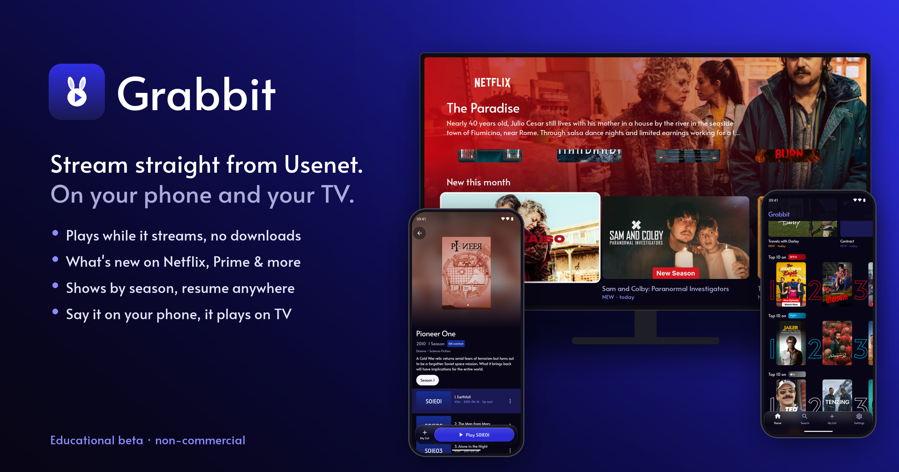
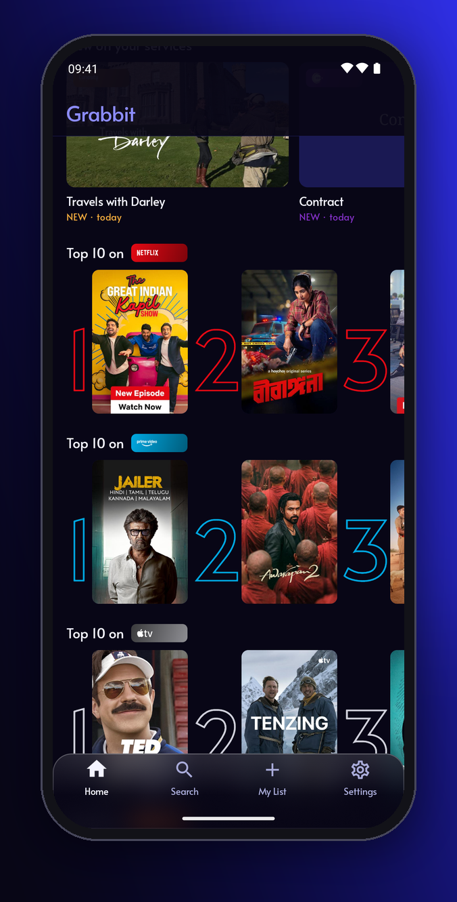
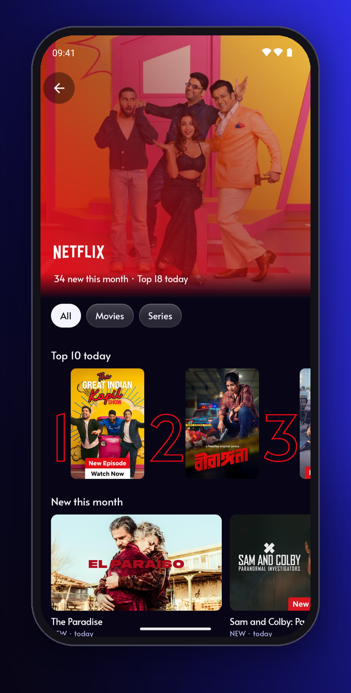
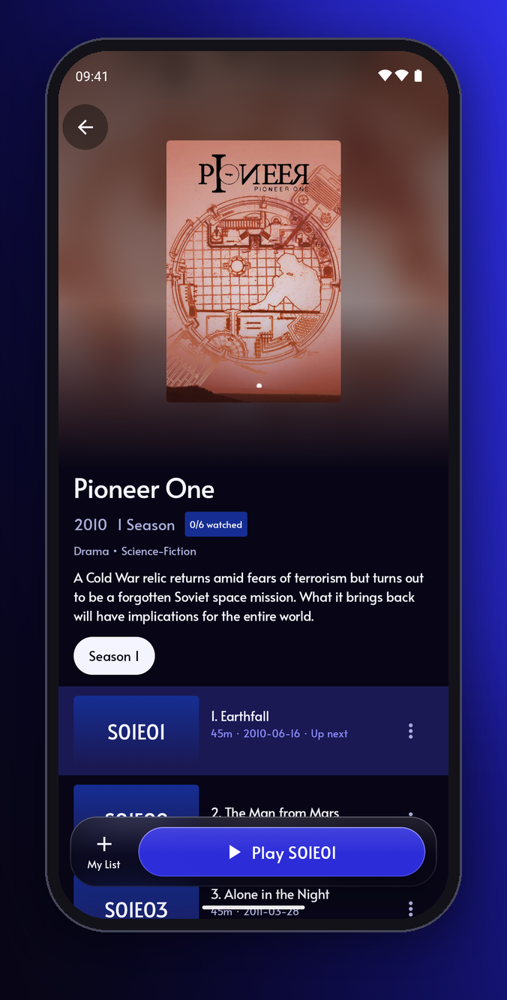
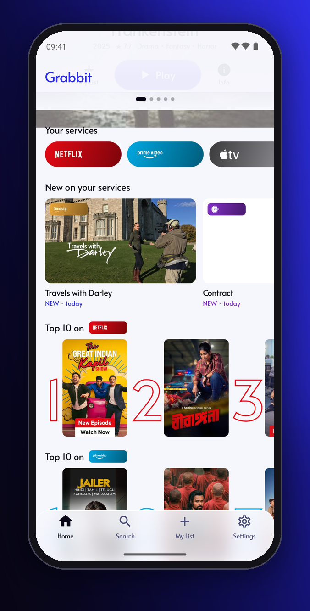
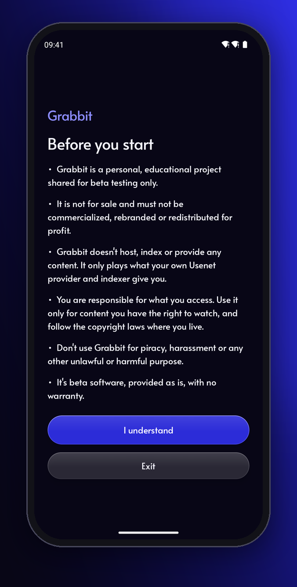
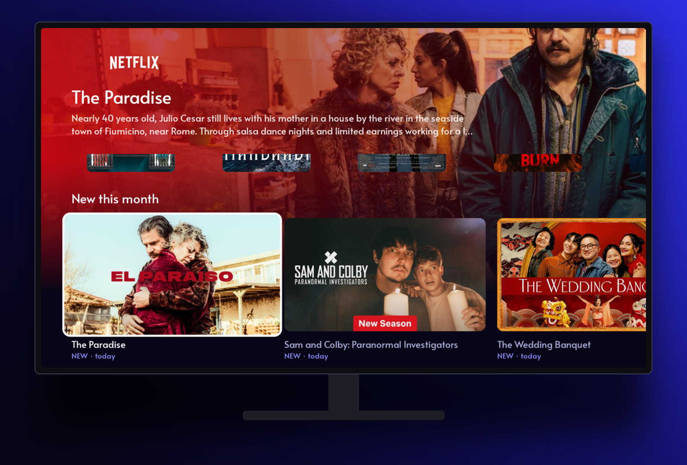
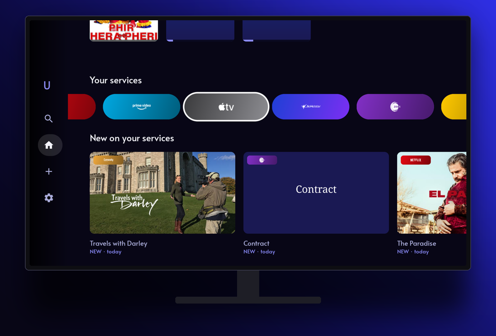
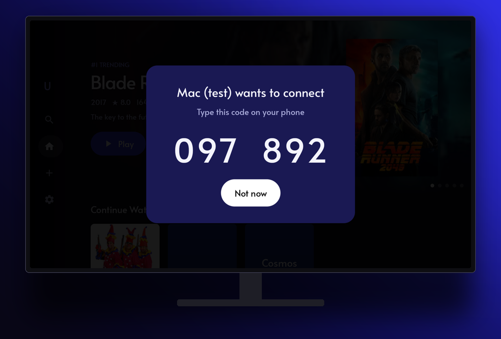

<p align="center"></p>

<h1 align="center">Grabbit</h1>
<p align="center"><b>Stream straight from Usenet, on your phone and your TV.</b><br>
No downloads, no waiting. Pick a title and it plays while it streams.</p>
<p align="center">
  
  
  
  
</p>

> **Educational, non-commercial beta.** Grabbit hosts, indexes and provides no content. It only plays what your own
> Usenet provider and indexer give you. See the [disclaimer](#disclaimer).

## Why Grabbit

- **Instant playback:** starts in seconds and seeks anywhere, straight from Usenet, nothing downloaded first.
  Reads through stored RAR and 7z sets, including password-protected 7z.
- **What's on, everywhere:** brand-coloured lanes for Netflix, Prime Video, Apple TV, JioHotstar and more.
  You get new arrivals, today's Top 10 and what's leaving soon, with a one-tap "Open in Netflix".
- **Built for shows:** seasons and episodes, per-episode progress, Continue Watching and autoplay of the next episode.
- **Phone and TV together:** a real Android TV app driven by the remote. Say a title into your phone and it plays on the TV.
- **Picks a copy that will play:** checks what your device can decode (HEVC, 4K, Dolby audio) and skips releases
  that would play as garbage.
- **Looks the part:** indigo dark and light themes, smooth animations and glassy controls.

## On your phone

| | | |
|:-:|:-:|:-:|
|  |  |  |
| **Your services, one home**<br>New and Top 10 per service | **Every service in its colours**<br>New, Top 10, leaving soon | **Shows by season**<br>Progress on every episode |
|  |  | |
| **Light or dark**<br>Follows your phone | **Clear ground rules**<br>Shown on first launch | |

## On your TV

<p align="center"><br><sub>A service page: the backdrop follows whatever you focus with the remote.</sub></p>

| | |
|:-:|:-:|
|  |  |
| **Lanes made for the remote** | **Pair your phone in one step**<br>The TV shows the code the moment you connect |

## What you need

- A **Usenet provider** account (e.g. NewsDemon, Eweka, Frugal): server, user name, password.
- A **Newznab indexer** API key (e.g. NZBGeek, NZBFinder, DrunkenSlug).
- Android 8+ phone, and/or an Android TV (Android 9+).

Grabbit never sends your server details or passwords anywhere except to your own provider and indexer.

## Install

1. Open **[Releases](../../releases/latest)** on your phone and download `Grabbit-<version>.apk`.
2. Tap it and allow "install unknown apps" for your browser when asked.
3. Open Grabbit → **Settings**, add your Usenet server and indexer.

**On an Android TV:** install the APK with the free *Downloader* app (enter the release link) or `adb install`.
Then, on the TV, open **Settings** and scan the QR code with your phone to type your server details on the phone.
Your phone can also search and start playback on the TV: phone **Settings → TV → Connect a TV**.

## Report a problem or suggest an idea

In the app: **Settings → Beta feedback** (on TV, scan the QR code). It opens a GitHub issue with your app version,
device and Android version already filled in, and labels it for us. You need a free GitHub account.

- **Playback problem**: wouldn't play, stuttered, no sound, wrong picture (the last error is filled in for you)
- **Something else is broken**: crashes, buttons, screens
- **Suggest an idea**

## Build it yourself

JDK 17 and the Android SDK. Optional beta settings go in `local.properties` (never committed):

```
grabbit.guideKey=<movieofthenight.com API key bundled into the APK>
grabbit.feedbackRepo=<owner>/<repo> for in-app feedback
```

`./gradlew :engine:test :app:testDebugUnitTest :app:assembleRelease`

## Disclaimer

Grabbit is a personal, **educational** project shared **for beta testing only**.

- It is **not for sale** and must not be commercialized, rebranded or redistributed for profit.
- It does **not host, index or provide any content**. It only plays what your own Usenet provider and indexer give you.
- **You are responsible for what you access.** Use it only for content you have the right to watch, and follow the
  copyright laws where you live.
- Don't use Grabbit for piracy, harassment or any other unlawful or harmful purpose.
- It's beta software, provided **as is, with no warranty**.

Screenshots show the built-in streaming guide (metadata from movieofthenight.com) and freely licensed works
(*Pioneer One*). Service names and logos belong to their owners and appear only to show where a title streams officially.
